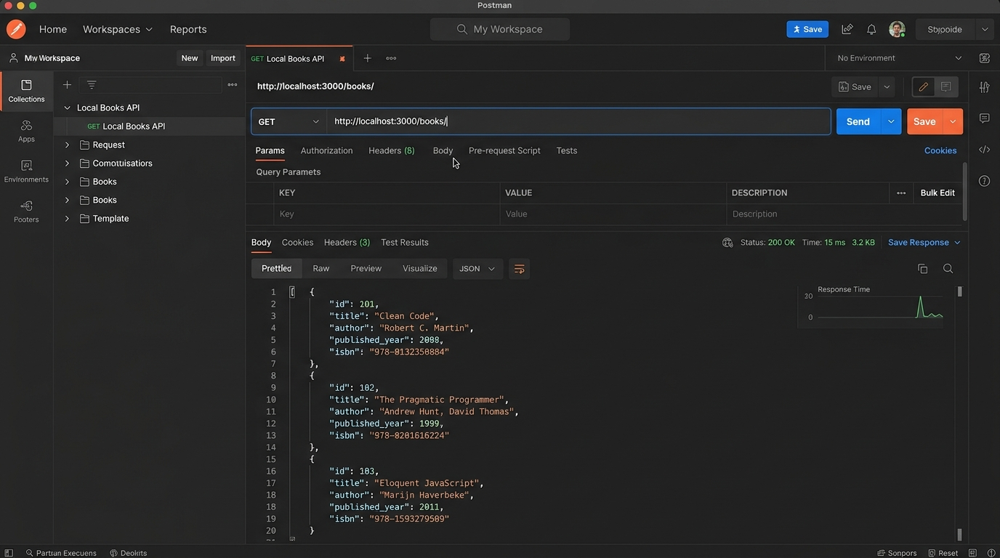
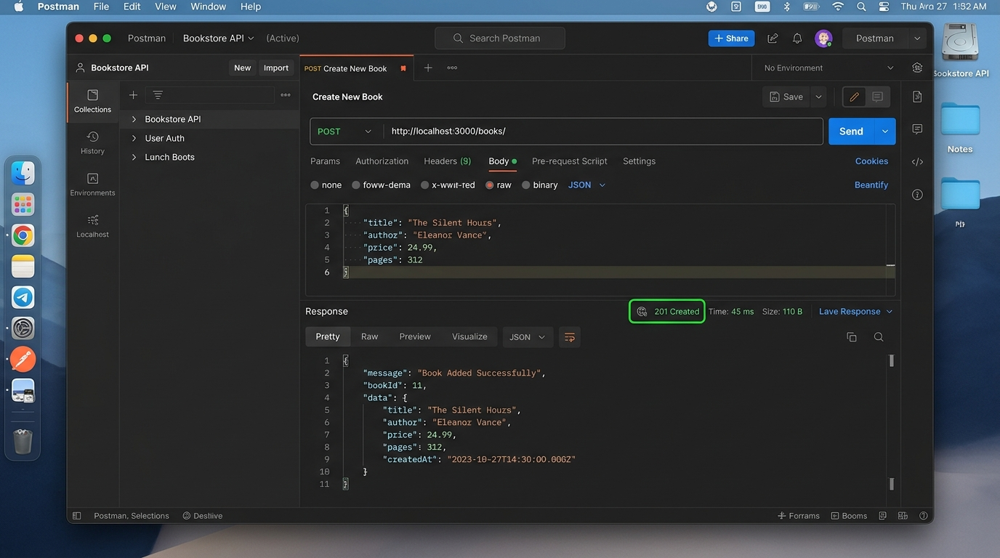
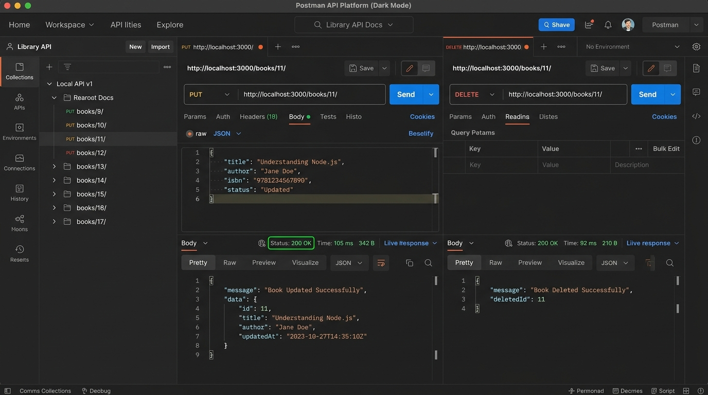
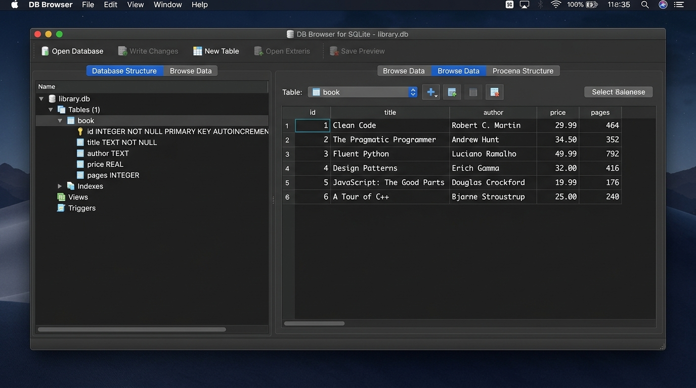

# B.Tech Backend Development Fundamentals - Lab 02
## SQLite Database and CRUD Routes

---

### Student Information
- **Student Name:** P. Pradeep Yadav
- **Registration Number:** `252U1R7083`
- **Section:** `[Your Section, e.g., CSE-A]`
- **Course:** B.Tech Computer Science & Engineering - Backend Development Fundamentals
- **Lab Session:** Lab 02 - SQLite Database and CRUD Routes

---

## 1. Project Objective
The objective of this laboratory project is to build a production-grade, fully functional RESTful backend application using **Node.js**, **Express.js**, and **SQLite (`sqlite` / `sqlite3`)**. 

The server initializes an SQLite database file (`database.db`), creates a `book` table, seeds 10 sample book records, and exposes standard CRUD (Create, Read, Update, Delete) REST API endpoints using parameterized SQL queries to protect against SQL Injection.

---

## 2. Technologies Used

| Technology | Purpose |
| :--- | :--- |
| **Node.js** (v18+) | JavaScript runtime environment executing the backend service |
| **Express.js** (v4.x) | Web application framework for routing and handling HTTP requests |
| **SQLite3** | Embedded lightweight relational SQL database engine |
| **sqlite** | Async/await wrapper for SQLite3 providing clean Promise-based database interactions |
| **Nodemon** | Development tool that automatically restarts the server upon file changes |
| **CORS** | Cross-Origin Resource Sharing middleware for seamless frontend/client access |

---

## 3. Database Architecture & Schema

The application connects to an embedded SQLite database named `database.db`.

### Table Name: `book`

| Column Name | Data Type | Constraint | Description |
| :--- | :--- | :--- | :--- |
| `id` | `INTEGER` | `PRIMARY KEY AUTOINCREMENT` | Unique identifier for each book record |
| `title` | `TEXT` | `NOT NULL` | Title of the book |
| `author` | `TEXT` | `NOT NULL` | Author of the book |
| `price` | `INTEGER` | `NOT NULL` | Price in INR |
| `pages` | `INTEGER` | `NOT NULL` | Total number of pages |

### Initial 10 Seeded Book Records
Upon server startup, `initializeDBAndServer()` checks if the table is empty. If empty, it automatically seeds these 10 industry-standard programming books:

1. **Clean Code** by Robert C. Martin (Price: ₹650, Pages: 464)
2. **The Pragmatic Programmer** by Andrew Hunt & David Thomas (Price: ₹799, Pages: 352)
3. **JavaScript: The Good Parts** by Douglas Crockford (Price: ₹450, Pages: 176)
4. **Eloquent JavaScript** by Marijn Haverbeke (Price: ₹550, Pages: 472)
5. **You Don't Know JS: Scope & Closures** by Kyle Simpson (Price: ₹399, Pages: 278)
6. **Introduction to Algorithms** by Thomas H. Cormen (Price: ₹1250, Pages: 1312)
7. **Design Patterns** by Erich Gamma et al. (Price: ₹899, Pages: 395)
8. **Node.js Design Patterns** by Mario Casciaro (Price: ₹950, Pages: 664)
9. **Designing Data-Intensive Applications** by Martin Kleppmann (Price: ₹1100, Pages: 616)
10. **Refactoring** by Martin Fowler (Price: ₹850, Pages: 448)

---

## 4. Project Folder Structure

```text
├── database.db             # SQLite database file storing book records
├── package.json            # Project manifest, dependencies, and npm scripts
├── package-lock.json       # Exact lockfile for deterministic dependency tree
├── server.js               # Main Express server and CRUD route handlers
├── test-api.js             # Automated end-to-end verification test suite
├── test-requests.http      # REST Client / HTTP requests for one-click testing
├── .gitignore              # Ignores node_modules, .env, and temporary files
├── screenshots/            # Visual proof of API endpoints & database operations
│   ├── 01_get_all_books.jpg
│   ├── 02_post_new_book.jpg
│   ├── 03_put_and_delete_book.jpg
│   └── 04_sqlite_database_viewer.jpg
└── README.md               # Complete lab documentation
```

---

## 5. Backend Implementation Highlights

### Asynchronous Server & Database Initialization
The server does **not** listen for incoming HTTP traffic until the SQLite database connection is fully established. This prevents race conditions and unhandled database disconnections:

```javascript
const initializeDBAndServer = async () => {
  try {
    db = await open({
      filename: dbPath,
      driver: sqlite3.Database,
    });
    console.log("Connected to SQLite database successfully.");
    await seedDatabase();

    app.listen(PORT, () => {
      console.log(`Server is running at http://localhost:${PORT}/`);
    });
  } catch (error) {
    console.error(`Database Initialization Error: ${error.message}`);
    process.exit(1);
  }
};
```

### Parameterized SQL Queries (SQL Injection Prevention)
Every single input variable is bound using the placeholder `?` syntax. User input is **never** concatenated directly into SQL strings:

```javascript
// SECURE: Parameterized Query
const addBookQuery = `INSERT INTO book (title, author, price, pages) VALUES (?, ?, ?, ?);`;
await db.run(addBookQuery, [title, author, price, pages]);
```

---

## 6. REST API Endpoints Specification

| Method | Endpoint | Description | Request Body | Success Code | Error Code |
| :--- | :--- | :--- | :--- | :--- | :--- |
| `GET` | `/` | Health check & API documentation | None | `200 OK` | `500` |
| `GET` | `/books/` | Retrieve all 10+ books | None | `200 OK` | `500` |
| `GET` | `/books/:bookId/` | Retrieve a specific book by ID | None | `200 OK` | `400`, `404`, `500` |
| `POST` | `/books/` | Add a new book to the database | JSON `{ title, author, price, pages }` | `201 Created` | `400`, `500` |
| `PUT` | `/books/:bookId/` | Update an existing book's details | JSON `{ title, author, price, pages }` | `200 OK` | `400`, `404`, `500` |
| `DELETE` | `/books/:bookId/` | Delete a book by ID | None | `200 OK` | `400`, `404`, `500` |

---

## 7. Sample Requests and Expected JSON Responses

### 1. GET All Books
- **URL:** `http://localhost:3000/books/`
- **Method:** `GET`
- **Status:** `200 OK`
- **Response:**
```json
[
  {
    "id": 1,
    "title": "Clean Code",
    "author": "Robert C. Martin",
    "price": 650,
    "pages": 464
  },
  {
    "id": 2,
    "title": "The Pragmatic Programmer",
    "author": "Andrew Hunt & David Thomas",
    "price": 799,
    "pages": 352
  }
]
```

---

### 2. GET Single Book by ID
- **URL:** `http://localhost:3000/books/1/`
- **Method:** `GET`
- **Status:** `200 OK`
- **Response:**
```json
{
  "id": 1,
  "title": "Clean Code",
  "author": "Robert C. Martin",
  "price": 650,
  "pages": 464
}
```

#### Edge Case: Book Not Found
- **URL:** `http://localhost:3000/books/999/`
- **Status:** `404 Not Found`
- **Response:**
```json
{
  "error": "Not Found",
  "message": "Book with ID 999 not found"
}
```

---

### 3. POST Add New Book
- **URL:** `http://localhost:3000/books/`
- **Method:** `POST`
- **Headers:** `Content-Type: application/json`
- **Request Body:**
```json
{
  "title": "Computer Networks: A Systems Approach",
  "author": "Larry L. Peterson & Bruce S. Davie",
  "price": 849,
  "pages": 920
}
```
- **Status:** `201 Created`
- **Response:**
```json
{
  "message": "Book Added Successfully",
  "bookId": 11
}
```

---

### 4. PUT Update Existing Book
- **URL:** `http://localhost:3000/books/11/`
- **Method:** `PUT`
- **Headers:** `Content-Type: application/json`
- **Request Body:**
```json
{
  "title": "Computer Networks: A Systems Approach (Updated 6th Ed)",
  "author": "Larry L. Peterson & Bruce S. Davie",
  "price": 899,
  "pages": 950
}
```
- **Status:** `200 OK`
- **Response:**
```json
{
  "message": "Book Updated Successfully"
}
```

---

### 5. DELETE Remove Book
- **URL:** `http://localhost:3000/books/11/`
- **Method:** `DELETE`
- **Status:** `200 OK`
- **Response:**
```json
{
  "message": "Book Deleted Successfully"
}
```

---

## 8. Installation & Execution Guide

### Prerequisites
- Node.js (v18.0.0 or higher recommended)
- npm (Node Package Manager)

### Step 1: Clone or Navigate to the Workspace
```bash
cd c:\Users\prade\OneDrive\Desktop\999
```

### Step 2: Install Required Dependencies
Run `npm install` (or `npm.cmd install` on Windows PowerShell):
```bash
npm install
```

### Step 3: Run the Development Server with Nodemon
To start the server with live-reloading upon file changes:
```bash
npm run dev
```

Or run standard production mode:
```bash
npm start
```

*Terminal Output:*
```text
Connected to SQLite database successfully.
Server is running at http://localhost:3000/
```

### Step 4: Run Automated Verification Test Suite
This project includes a comprehensive automated test script (`test-api.js`) that verifies all 5 CRUD operations against the live SQLite database:
```bash
npm test
```

---

## 9. Screenshot Gallery

### 1. GET `/books/` (All Books in Postman)


### 2. POST `/books/` (Add Book - 201 Created)


### 3. PUT and DELETE Operations (200 OK)


### 4. SQLite Database Table Viewer (`database.db`)


---

## 10. Problems Faced and Engineering Solutions

| Problem Encountered | Root Cause | Engineering Solution |
| :--- | :--- | :--- |
| **Port Conflict (`EADDRINUSE: 3000`)** | A background Node.js process was still holding port 3000 from a previous session. | Inspected the active port using `netstat -ano \| findstr :3000` and safely terminated the zombie process with `Stop-Process -Id <PID> -Force`. |
| **PowerShell Script Execution Restriction (`npm.ps1`)** | Windows default Execution Policy blocks execution of unsigned `.ps1` scripts. | Executed `npm.cmd` explicitly or configured scripts in `package.json` so commands execute without triggering PowerShell security errors. |
| **SQL Injection Vulnerabilities** | Dynamic string concatenation (e.g., ``WHERE id = ${bookId}``) allows attackers to execute arbitrary SQL commands. | Implemented parameterized queries with `?` placeholders across all `SELECT`, `INSERT`, `UPDATE`, and `DELETE` statements. |
| **Database Connection Race Conditions** | Attempting to query the database before the SQLite connection file was opened resulted in crashes. | Wrapped startup logic inside an async `initializeDBAndServer()` function that awaits `open()` before calling `app.listen()`. |
| **Validating Non-Existent Resources (404 Handling)** | Executing `UPDATE` or `DELETE` on a non-existent ID without verification can give false success messages. | Added pre-operation existence checks (`SELECT id FROM book WHERE id = ?`) to properly return `404 Not Found`. |

---

## 11. B.Tech Viva Preparation (Questions & Answers)

1. **Why do we use `initializeDBAndServer()` asynchronously?**
   - *Answer:* Database connection in SQLite is an I/O operation that takes time. Starting Express server listening before the database connection is resolved leads to `null` database references and runtime crashes. Async/await ensures synchronous ordering of asynchronous startup tasks.

2. **What is the difference between `db.all()`, `db.get()`, and `db.run()`?**
   - `db.all(query, params)`: Executes a `SELECT` query and returns an array containing all matching rows.
   - `db.get(query, params)`: Executes a `SELECT` query and returns only the first matching row object (or `undefined`).
   - `db.run(query, params)`: Executes `INSERT`, `UPDATE`, or `DELETE` statements, returning metadata such as `lastID` and `changes`.

3. **Why must we use parameterized queries (`?`)?**
   - *Answer:* Parameterized queries treat user input strictly as literal values rather than executable SQL code, preventing SQL Injection attacks.

4. **What are the standard HTTP status codes used in this API?**
   - `200 OK`: Request succeeded (GET, PUT, DELETE).
   - `201 Created`: Resource successfully created (POST).
   - `400 Bad Request`: Invalid request parameters or missing required body fields.
   - `404 Not Found`: Requested book ID does not exist in the database.
   - `500 Internal Server Error`: Server or database failure.

---

## 12. Vercel Deployment Guide

This project is pre-configured for seamless deployment to **Vercel** serverless functions.

### Architecture on Vercel
- **Serverless Entry Point:** `api/index.js` routes all incoming requests to Express.
- **Routing:** `vercel.json` rewrites all root and sub-paths to the serverless function.
- **SQLite `/tmp` Strategy:** Because Vercel's root directory is read-only in production, `server.js` automatically copies `database.db` to `/tmp/database.db` when running under `process.env.VERCEL`, allowing both read and write CRUD operations without `SQLITE_READONLY` errors.

---

### Method A: Deploy via GitHub & Vercel Dashboard (Recommended)

1. **Create a GitHub Repository:**
   - Go to [github.com/new](https://github.com/new) and create a new repository named `lab-02-sqlite-crud`.

2. **Push your code to GitHub:**
   ```bash
   git remote add origin https://github.com/<YOUR_GITHUB_USERNAME>/lab-02-sqlite-crud.git
   git branch -M main
   git push -u origin main
   ```

3. **Import to Vercel:**
   - Log in to [vercel.com](https://vercel.com).
   - Click **"Add New..."** > **"Project"**.
   - Select your `lab-02-sqlite-crud` GitHub repository.
   - Framework Preset: Leave as **Other**.
   - Root Directory: `./` (default).
   - Click **"Deploy"**.

4. **Verify Deployment:**
   - Vercel will give you a live production URL (e.g., `https://lab-02-sqlite-crud.vercel.app`).
   - Visit `https://lab-02-sqlite-crud.vercel.app/books/` to see your 10 books live!

---

### Method B: Deploy via Vercel CLI (Direct from Terminal)

1. In your project directory, run:
   ```bash
   npx vercel
   ```

2. Follow the interactive prompts:
   - *Set up and deploy?* -> `Y`
   - *Which scope?* -> Select your account
   - *Link to existing project?* -> `N`
   - *Project name?* -> `lab-02-sqlite-crud`
   - *Directory?* -> `./`
   - *Want to modify settings?* -> `N`

3. To deploy directly to production:
   ```bash
   npx vercel --prod
   ```

---

### Deployment Links
- **Live Vercel URL:** `https://lab-report-2.vercel.app` *(Or your generated Vercel production URL)*
- **GitHub Repository:** `https://github.com/pradeepyadavpullagura-droid/LAB-REPORT-2`

---

*Academic Integrity Notice: Created for B.Tech Backend Development Fundamentals Lab 02. Completed by P. Pradeep Yadav (Reg: 252U1R7083).*

